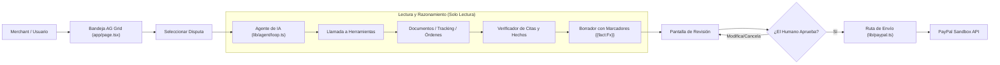

# 🏗️ Guía 03: Arquitectura y Tecnologías

En esta guía conocerás la infraestructura tecnológica de DisputeDesk, cómo están organizados los archivos y por qué se eligió cada librería.

---

## 1. Stack Tecnológico

| Capa | Tecnología | Justificación |
| :--- | :--- | :--- |
| **Framework Web** | **Next.js 14 (App Router)** | Renderizado del lado del servidor (SSR), Server Actions seguras para llamadas a PayPal sin exponer credenciales al cliente y excelente rendimiento. |
| **Lenguaje** | **TypeScript 5** | Tipado estricto en todas las capas; contratos de API seguros con Zod para validar datos de entrada y salidas del modelo de IA. |
| **Estilos** | **Tailwind CSS** | Diseño rápido, limpio y responsivo con soporte de modo oscuro y banner persistente de Sandbox. |
| **Tablas de Datos** | **AG Grid Community (`ag-grid-react`)** | La librería de tablas más potente del ecosistema JavaScript. Permite ordenar, filtrar y visualizar disputas con facilidad (además de calificar para el premio de patrocinador de AG Grid). |
| **Integración PayPal** | **REST Directo (Fetch)** | Sin SDKs obsoletos ni intermediarios. Llamadas HTTPS limpias a `api-m.sandbox.paypal.com` protegidas en el backend. |
| **Inteligencia Artificial** | **Adaptador Agnóstico (`lib/llm`)** | Soporta **Google AI Studio (Gemini)** por defecto y cualquier API compatible con **OpenAI**. No se ata a una sola empresa ni requiere nombres de modelos fijos en el código. |
| **Manejo de PDFs** | **`pdf-parse` & `pdf-lib`** | `pdf-parse` para extraer texto capa a capa y verificar citas; `pdf-lib` para generar PDFs sintéticos de prueba con marcas de agua. |
| **Validación de Datos** | **Zod** | Valida el esquema de cada JSON que el LLM genera y cada petición que llega a la API. |
| **Pruebas Automatizadas** | **Vitest** | Pruebas unitarias ultrarrápidas con mocks para simular llamadas a PayPal y al LLM sin gastar cuota. |

---

## 2. Estructura de Directorios del Proyecto

El proyecto sigue una estructura limpia y modular:

```text
dispute-desk/
├── app/                        # Next.js App Router (Páginas y Rutas de API)
│   ├── layout.tsx              # Marco global con banner de PayPal Sandbox
│   ├── page.tsx                # Página principal (Bandeja AG Grid de disputas)
│   ├── not-found.tsx           # Manejo de error 404
│   ├── globals.css             # Estilos globales y directivas de Tailwind
│   └── api/                    # Rutas de backend (proxy a PayPal, LLM, etc.)
│
├── components/                 # Componentes de React reutilizables
│   ├── DisputeGrid.tsx         # Tabla principal de disputas con AG Grid
│   ├── CaseView.tsx            # Vista de 3 paneles de la disputa seleccionada
│   ├── DocViewer.tsx           # Visor de documentos con cita resaltada
│   ├── TracePanel.tsx          # Panel lateral con la traza de pasos del agente
│   ├── ClaimTable.tsx          # Tabla de contraste de afirmaciones (Claim Check)
│   ├── EvidenceList.tsx        # Paquete de hechos y evidencias
│   └── ApproveDialog.tsx       # Diálogo modal de confirmación y envío a PayPal
│
├── lib/                        # Lógica de negocio y librerías auxiliares
│   ├── env.ts                  # Validación de variables de entorno y guardia Sandbox
│   ├── paypal.ts               # Conector OAuth, consultas y Provide-Evidence
│   ├── llm/                    # Adaptador de IA (Gemini REST y OpenAI-compatible)
│   └── agent/                  # Bucle del agente, herramientas, extractor y verificador
│
├── data/                       # Datos sintéticos y análisis en caché
│   ├── demo-disputes.json      # 10 casos de disputa sintéticos listos para demo
│   ├── demo-analyses.json      # Análisis pre-calculados (fallback si no hay API key)
│   └── docs/                   # PDFs sintéticos de facturas, guías y chats
│
├── scripts/                    # Scripts de utilidad y diagnóstico
│   ├── paypal-token.mjs        # Prueba de token OAuth2 de PayPal
│   ├── list-disputes.mjs       # Lista disputas del sandbox
│   ├── create-order.mjs        # Crea orden de prueba en sandbox
│   └── check-llm.mjs           # Diagnóstico del modelo de IA
│
├── estudio/                    # 📚 Documentación y guías de estudio para ti
├── SPEC.md                     # Especificación técnica maestra del hackathon
├── package.json                # Dependencias y scripts
└── tailwind.config.ts          # Configuración del sistema de diseño
```

---

## 3. Flujo de Datos Arquitectónico



> [!IMPORTANT]
> Observa que el bloque de IA **está aislado** de la acción de envío `provide-evidence`. La IA únicamente propone el borrador y fundamenta los hechos; la conexión con PayPal para responder la disputa ocurre solo tras el visto bueno humano.

